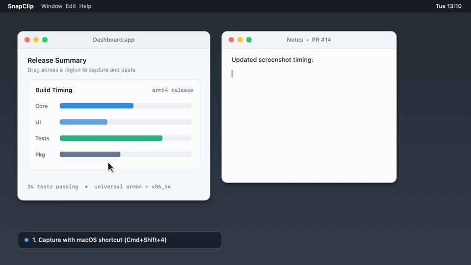

<div align="center">

# SnapClip

### Copy macOS screenshots to the clipboard, save to Desktop, and skip the 5-second thumbnail delay

[](https://github.com/aklkbqx/snapclip/releases)
[](#homebrew)
[](https://github.com/sponsors/aklkbqx)
[](LICENSE)
[](https://github.com/aklkbqx/snapclip/releases)
[](https://github.com/aklkbqx/snapclip/releases)

<br/>

<a href="#how-it-works">
  
</a>

<p>
  <a href="#why-it-exists">Why it exists</a> ·
  <a href="#stock-macos-vs-snapclip">Comparison</a> ·
  <a href="#install">Install</a> ·
  <a href="#commands">Commands</a> ·
  <a href="#preview-controls">Preview controls</a> ·
  <a href="#configuration">Configuration</a> ·
  <a href="#how-it-works">How it works</a> ·
  <a href="#faq">FAQ</a> ·
  <a href="#support">Support</a>
</p>

</div>

SnapClip is an open-source macOS background utility written in Swift that lets `Cmd+Shift+3`, `Cmd+Shift+4`, and `Cmd+Shift+5` copy screenshots to your clipboard and save the image file to `~/Desktop` at the same time. Because it watches the staging folder where macOS `screencapture` already writes files, SnapClip requires **no Screen Recording or Accessibility permissions**.

```text
  Cmd+Shift+3 / 4 / 5 --> ~/.local/state/snapclip/staging --+--> clipboard (PNG + TIFF)
                                                            +--> ~/Desktop/Screenshot ...png
                                                            +--> corner preview on cursor display
```

## Why it exists

Stock macOS `screencapture` forces a choice between pasting fast and keeping files:

- Pressing `Cmd+Shift+4` saves a file to Desktop, does **not** copy it to the clipboard, and holds the file in memory for ~5 seconds while the native corner thumbnail stays on screen.
- Pressing `Cmd+Ctrl+Shift+4` (or setting `target` to `clipboard`) copies to the clipboard, skips saving the file, and shows no corner preview for drag-and-drop.

`snapclip install` backs up your existing `com.apple.screencapture` preferences, disables the 5-second native thumbnail write delay (`show-thumbnail = 0`), points screenshots at a local staging directory, and loads a lightweight `LaunchAgent` (`com.snapclip.agent`). Every capture is copied onto your clipboard, moved to `~/Desktop`, and shown in a non-blocking corner card right away. `snapclip uninstall` unloads the agent and restores your original macOS settings.

## Stock macOS vs. SnapClip

| Capability | Stock `Cmd+Shift+4` (`target=file`) | Stock `Cmd+Ctrl+Shift+4` (`target=clipboard`) | SnapClip |
| --- | --- | --- | --- |
| Copies PNG + TIFF to clipboard | No | Yes | Yes, immediately |
| Saves image file to `~/Desktop` | Delayed ~5s while thumbnail is visible | No | Yes, immediately (or optional clipboard-only mode) |
| Floating corner preview | Blocks file write until dismissed | None | Non-blocking card on the display holding your cursor |
| Drag-and-drop file from preview | Yes | No | Yes |
| Hover Trash & Close buttons | Right-click menu only | No | One-click Move to Trash (`trash`) and Close (`xmark`) |
| Screen Recording / Accessibility TCC | Built into macOS | Built into macOS | **None required** |

## Install

Requires macOS 14 (Sonoma) or newer on Apple Silicon (`arm64`) or Intel (`x86_64`).

### Homebrew

```sh
brew install aklkbqx/snapclip/snapclip
snapclip install
snapclip doctor
```

### Release archive

Download `snapclip_<version>_darwin_universal.tar.gz` and `SHA256SUMS` from [GitHub Releases](https://github.com/aklkbqx/snapclip/releases/latest), verify the checksum, and place `snapclip` on your `PATH`:

```sh
shasum -a 256 -c SHA256SUMS
tar -xzf snapclip_*_darwin_universal.tar.gz
install -m 755 snapclip ~/.local/bin/snapclip
snapclip install
```

### Build from source

Requires Swift 6.0+ (zero external Swift package dependencies):

```sh
git clone https://github.com/aklkbqx/snapclip.git
cd snapclip
make verify
make install
```

Add `~/.local/bin` to your `PATH` if needed, then enable the `LaunchAgent` and staging preferences:

```sh
snapclip install
snapclip doctor
```

### Uninstall

To stop the background agent and restore your backed-up `com.apple.screencapture` preferences back to stock macOS behavior:

```sh
snapclip uninstall
```

## Commands

| Command | What it does |
| --- | --- |
| `snapclip run [--config <path>] [--clipboard-only] [--no-preview]` | Run the foreground watcher (invoked by `launchd`) |
| `snapclip install [--no-load] [--migrate-agent <label>]` | Back up `screencapture` defaults, apply staging config, and load `LaunchAgent` |
| `snapclip uninstall` | Unload `LaunchAgent` and restore backed-up `screencapture` settings |
| `snapclip status [--json]` | Print daemon health, staging queue count, and destination path |
| `snapclip doctor [--json] [--conflict-agent <label>]` | Verify binary, directories, `screencapture` defaults, and `launchd` state |
| `snapclip config [show\|init\|path]` | Print active config, write defaults, or print the config file path |
| `snapclip donate [github] [--open] [--json]` | Print the GitHub Sponsors URL, or open it in your browser |
| `snapclip version` | Print the installed version |

<p align="center">
  
</p>

## Preview controls

The floating card appears in the bottom-right corner of whichever monitor currently holds your mouse cursor and never steals window focus while you type.

- **Click**: open the saved screenshot in Preview (in `--clipboard-only` mode where no file is kept, clicking dismisses the card).
- **Drag left or up**: drag the image file straight into a browser, Slack, Finder, PR comment, or terminal.
- **Hover top-right buttons**: move the saved screenshot to macOS Trash (`trash`) or close the preview (`xmark`).
- **Swipe right or right-click**: dismiss the card without deleting the saved file.

## Configuration

Create `~/.config/snapclip/config.json`:

```sh
snapclip config init
```

Default values:

```json
{
  "destinationDirectory": "~/Desktop",
  "includeTiffOnPasteboard": true,
  "keepFile": true,
  "logPath": "~/Library/Logs/snapclip.log",
  "maxLogSizeBytes": 1048576,
  "previewAutoDismissSeconds": 4.5,
  "previewHoverDismissSeconds": 2.5,
  "showFloatingPreview": true,
  "stagingDirectory": "~/.local/state/snapclip/staging",
  "stateDirectory": "~/.local/state/snapclip",
  "watchScreenRecordings": true
}
```

## How it works

`SnapClipCore` opens the staging directory with kernel vnode notifications (`O_EVTONLY`), sorts pending captures oldest-first so rapid bursts keep chronological order, waits asynchronously for valid image trailers and stable byte counts via `ImageIO`, writes PNG plus LZW-compressed TIFF onto a single `NSPasteboardItem`, and moves the finalized file into `destinationDirectory` (with automatic numbered collision suffixes if a filename already exists).

Custom workflows can attach through the `CapturePostProcessor` and `CaptureActionSink` protocols without modifying the directory watcher.

## FAQ

### How does SnapClip capture screenshots without Screen Recording permission?
SnapClip does not capture your screen or intercept keyboard shortcuts. macOS's built-in `screencapture` process still takes the screenshot and writes it to `~/.local/state/snapclip/staging`. SnapClip only watches that directory and processes completed files.

### Why does stock macOS wait 5 seconds before saving screenshots to Desktop?
When `com.apple.screencapture` has `show-thumbnail` enabled, macOS delays writing the screenshot to its final folder until the floating thumbnail auto-dismisses. `snapclip install` sets `show-thumbnail = 0` so macOS flushes the file immediately, while SnapClip renders its own non-blocking corner preview after the file and clipboard are already ready.

### Does SnapClip work with non-English macOS languages and screen recordings?
Yes. SnapClip matches files in the staging directory by media extension (`png`, `jpg`, `jpeg`, `heic`, `tiff`, `tif`, `webp`, and `mov` / `mp4` when `watchScreenRecordings` is `true`) rather than English filename prefixes, so localized macOS filenames work out of the box. Screen recordings are moved cleanly to `destinationDirectory` once recording finishes without overwriting your image clipboard.

### Can I copy screenshots to the clipboard without keeping files on Desktop?
Yes. Set `"keepFile": false` in `~/.config/snapclip/config.json` (or pass `--clipboard-only` to `snapclip run`). SnapClip will copy each screenshot to the clipboard, show the corner preview if enabled, and remove the staged file instead of saving it to `~/Desktop`.

### What happens if I uninstall SnapClip?
Running `snapclip uninstall` unloads `com.snapclip.agent`, deletes its `LaunchAgent` plist, and restores your original `com.apple.screencapture` keys from `~/.local/state/snapclip/backup-defaults.json`.

## Packaging

Build a universal macOS (`arm64` + `x86_64`) release archive, `SHA256SUMS`, and Homebrew formula under `dist/packages/`:

```sh
make package
```

## Security and privacy

SnapClip opens no network sockets, makes no background HTTP requests while watching captures, and collects no telemetry. All files stay in your user directories. See [SECURITY.md](SECURITY.md).

## Contributing

See [CONTRIBUTING.md](CONTRIBUTING.md) and our [Code of Conduct](CODE_OF_CONDUCT.md).

## Support

SnapClip is free and open-source software under the MIT License. If it saves you time capturing and sharing screenshots on macOS, you can support ongoing development via [GitHub Sponsors](https://github.com/sponsors/aklkbqx):

```sh
# Print the GitHub Sponsors URL
snapclip donate

# Open GitHub Sponsors in your browser
snapclip donate --open
```

## License

Distributed under the MIT License. See [LICENSE](LICENSE).
