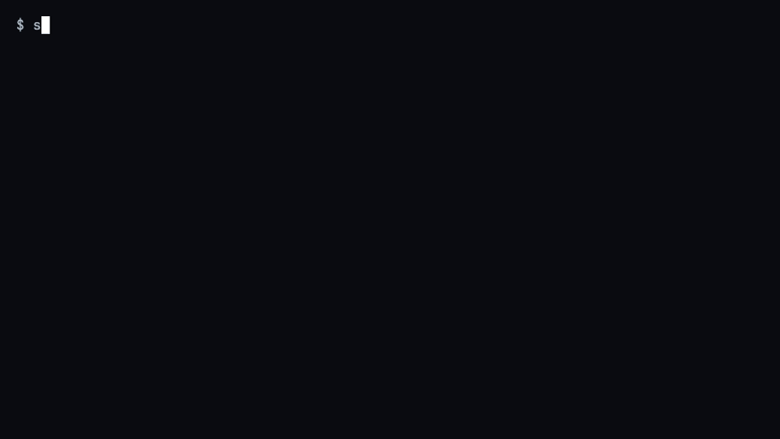

# Commands and configuration

## Commands

| Command | What it does |
| --- | --- |
| `snapclip install [--no-load] [--migrate-agent <label>]` | Back up `screencapture` settings, point them at the staging folder, and load the `LaunchAgent` |
| `snapclip uninstall` | Unload the `LaunchAgent` and restore the backed-up `screencapture` settings |
| `snapclip status [--json]` | Print agent health, how many captures are waiting, and the destination folder |
| `snapclip doctor [--json] [--conflict-agent <label>]` | Check the binary, folders, `screencapture` settings, and `launchd` state |
| `snapclip config [show\|init\|path]` | Print the active config, write the defaults to a file, or print the file path |
| `snapclip donate [github] [--open] [--json]` | Print the GitHub Sponsors URL, or open it in your browser |
| `snapclip version` | Print the installed version |
| `snapclip run [--config <path>] [--clipboard-only] [--no-preview]` | Run the watcher in the foreground. `launchd` starts this for you; run it by hand only to debug |

<p align="center">
  
</p>

## Configuration

The config file is `~/.config/snapclip/config.json`. Create it with:

```sh
snapclip config init
```

Every key is optional; omitted keys use these defaults:

```json
{
  "destinationDirectory": "~/Desktop",
  "includeTiffOnPasteboard": true,
  "keepFile": true,
  "logPath": "~/Library/Logs/snapclip.log",
  "maxLogSizeBytes": 1048576,
  "previewAutoDismissSeconds": 4.5,
  "previewHoverDismissSeconds": 2.5,
  "showFloatingPreview": true,
  "stagingDirectory": "~/.local/state/snapclip/staging",
  "stateDirectory": "~/.local/state/snapclip",
  "watchScreenRecordings": true
}
```

| Key | Meaning |
| --- | --- |
| `destinationDirectory` | Where finished screenshots are saved |
| `keepFile` | `false` copies to the clipboard only and removes the file (same as `snapclip run --clipboard-only`) |
| `showFloatingPreview` | Show the corner preview card |
| `previewAutoDismissSeconds` / `previewHoverDismissSeconds` | How long the card stays, and how long after the pointer leaves it (minimum 0.5) |
| `includeTiffOnPasteboard` | Also put a TIFF copy on the clipboard next to the PNG |
| `watchScreenRecordings` | Route `Cmd+Shift+5` `.mov` / `.mp4` screen recordings to the destination folder and show a corner preview card (the clipboard is left alone) |
| `stagingDirectory` | The folder macOS writes captures to before SnapClip handles them |
| `stateDirectory`, `logPath`, `maxLogSizeBytes` | Internal state, log file, and log size limit (minimum 16384) |
